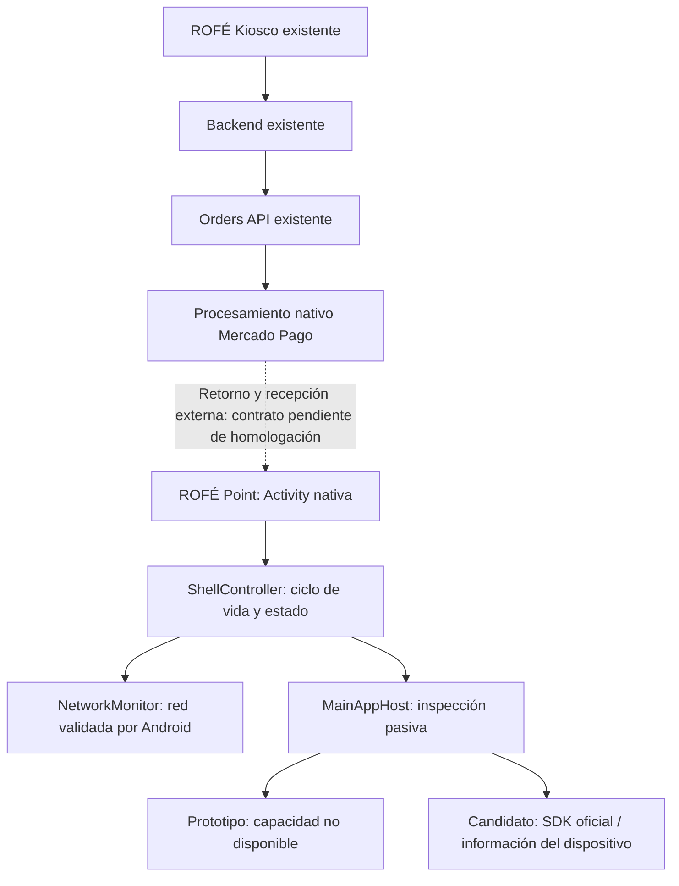

# ROFÉ Point — prototipo nativo y candidato Main App

Estado: desarrollo aislado; **sin homologación ni instalación en una Point comercial**.
Este prototipo local se prepara por instrucción del propietario. La factibilidad
comunicada por soporte no equivale al contacto formal con negocios ni al inicio de
una integración oficial; ambos siguen pendientes. La compatibilidad del conjunto
N950 + SELF_SERVICE + Orders externos sigue sujeta a homologación.
La **decisión financiera definitiva está pendiente**: no se ha elegido migrar al
SDK de pagos ni se da por aprobada su coexistencia con Orders API. Esta fase prepara
interfaz, seguridad y puertos de integración, sin registrar una aplicación en Mercado Pago.

## Alcance entregado

Módulo Kotlin `:point` dentro de `android-kiosk`, independiente de `:app` (Kiosco)
y `:barista`. Comparte herramientas Gradle, no su WebView ni sus componentes de negocio.
Usa Android Views, los colores de `src/styles/foundation.css` y las fuentes locales
Bricolage Grotesque/Outfit ya utilizadas por ROFÉ. No descarga recursos visuales.

La pantalla muestra ROFÉ, «Esperando cobro» y «Realiza tu pedido en la pantalla de
autoservicio». Tiene estados de desconexión, inspección y error recuperable. Siempre
explicita que el prototipo no procesa cobros o que falta configurar/homologar la integración.
La indicación «Red disponible» procede de Android; no significa que Mercado Pago
esté operativo ni que exista una orden pendiente.

No se cambiaron backend, Orders API, webhooks, credenciales, identificación de
terminal, modo SELF_SERVICE ni la APK Kiosco/Barista. No existe una función para
crear, reenviar, cancelar o consultar pagos en ROFÉ Point.

## Arquitectura y límite financiero



`MainAppHost` solo permite inspeccionar capacidades. La variante `mainapp` utiliza
realmente `MPManager.initialize`, `MPConfigBuilder` y `smartInformationTools.getInformation`
del AAR oficial 7.3.1. No se habilitan Bluetooth, cámara, impresión, SSO ni
`launchPaymentFlow`. Sin Client ID autorizado el SDK ni siquiera se inicializa.
Como el AAR local no aporta dependencias transitivas, la variante añade Gson 2.15.0,
necesario para `MPConfigBuilder`; el prototipo no lo necesita. Una prueba ejecuta el
SDK real en Robolectric sin host oficial y comprueba el fallo seguro, no un pago.
Una respuesta válida de información N950 produce `HOMOLOGATION_REQUIRED`, nunca
«terminal lista para cobrar». El número de serie y el resto del resultado no se guardan.
La consulta está documentada en [información del terminal](https://www.mercadopago.com.mx/developers/es/docs/smartapps/terminal-features/get-terminal-information).

La guía de [flujo nativo](https://www.mercadopago.com.mx/developers/es/docs/smartapps/integrate-payment-flow)
documenta iniciar un pago con el SDK y recibir su callback. No demuestra que ese
callback corresponda a una orden creada externamente por Orders API. Invocarlo
además del envío actual podría iniciar un cobro distinto: esta aplicación no lo hace.
No se inventaron broadcasts, deep links, paquetes de destino ni respuestas financieras.
Cuando Mercado Pago entregue el contrato de recepción/retorno se ampliará el puerto
con su adaptador oficial y pruebas de sandbox. No debe sustituirse por polling de
órdenes ni por una nueva credencial de producción dentro de la APK.

## Ciclo de vida, recuperación y errores

- `onResume`: reconstruye el estado de espera, vuelve a observar la red e inspecciona
  capacidades. No interpreta el retorno como pago aprobado ni modifica un pedido.
- `onPause`/`onDestroy`: elimina callbacks de red y temporizadores. Descarta respuestas
  de inspecciones anteriores. No intenta volver al primer plano mientras otra app opera.
- Consulta sin respuesta: después de diez segundos muestra un error recuperable.
  «Comprobar de nuevo» solo repite diagnóstico; nunca reenvía un cobro.
- Cambio de red: actualiza la presentación sin crear solicitudes financieras.
- Recreación/rotación/muerte del proceso: se vuelve a construir la interfaz; no hay
  transacciones locales que restaurar o repetir.
- Mantiene la pantalla encendida solo mientras su Activity está visible y reaplica
  inmersión al recuperar el foco. No utiliza servicios de arranque, Device Owner,
  accesibilidad, superposiciones ni un bucle que fuerce el foreground.
- `SafeDiagnostics` admite únicamente eventos enumerados y código de versión. No
  acepta mensajes arbitrarios, excepciones, URLs, tokens, importes ni identificadores.
  La política interna de logs del SDK debe revisarse con Mercado Pago en sandbox.

## Seguridad y acceso administrativo

No hay pantalla administrativa, PIN predeterminado, historial, cobro manual, ajustes,
lector de tarjetas, almacenamiento de pagos, receptor remoto ni servidor HTTP.
Los extras recibidos al abrir la Activity se ignoran. No se solicita cámara, NFC,
ubicación, almacenamiento, acceso a paquetes globales ni permisos de administración.
El prototipo solo solicita `ACCESS_NETWORK_STATE`; el candidato añade `INTERNET`.
AndroidX puede declarar su permiso interno de receptor no exportado, que no otorga
acceso a hardware. Backup y tráfico HTTP están deshabilitados.

Si se necesita administración propia, deberá añadirse una sesión de personal
verificada por backend/identidad oficial y permisos del servidor, con expiración;
no se considera implementada mediante ocultación o una pulsación secreta.
La recuperación administrativa del terminal comercial debe acordarse con Mercado Pago.

**Pantalla completa no equivale a un bloqueo de seguridad del sistema.** La documentación
de [fullscreen](https://www.mercadopago.com.mx/developers/es/docs/smartapps/terminal-features/configure-full-screen)
advierte que la navegación vuelve a mostrarse en las pantallas nativas de pago.
Nuestra Activity no puede garantizar por sí sola que nunca aparezca Smart Launcher,
notificaciones o ajustes durante esas pantallas. El bloqueo integral y el retorno
después de aprobación, cancelación y expiración requieren validación oficial.
La implementación utiliza [WindowInsetsController](https://developer.android.com/develop/ui/views/layout/immersive),
sin permisos especiales para deshabilitar barras del sistema.

## Variantes, identidades y compilación

| Variante | Identificador | HOME | SDK |
|---|---|---|---|
| `prototypeDebug` | `com.rofe.point.prototype.debug` | No | No |
| `prototypeRelease` | `com.rofe.point.prototype` | No | No |
| `mainappDebug` | `com.rofe.point.debug` | Sí | Oficial, inspección condicionada |
| `mainappRelease` | `com.rofe.point` | Sí | Oficial, configuración y firma obligatorias |

`mainapp` declara MAIN/HOME/DEFAULT según el
[contrato de desarrollo oficial](https://www.mercadopago.com.mx/developers/es/docs/smartapps/development-environment).
Declarar HOME no lo convierte automáticamente en el predeterminado.
No se selecciona ningún launcher por código ni mediante un script.
Esta variante no debe instalarse en una terminal comercial como prueba.

Requisitos: JDK 17, SDK Android 35, Build Tools compatibles (localmente 34.0.0),
Gradle Wrapper 8.11.1, AGP 8.7.3 y Kotlin 2.0.21 del proyecto existente. Mínimo API31
(Android 12); sin Google Play Services. La versión inicial es 1.0.0, código 1.
No cambies las versiones de Kiosco o Barista para compilar Point.

```bash
cd android-kiosk
# JAVA_HOME y ANDROID_HOME deben apuntar a tu JDK 17 / SDK; local.properties no va a Git.
./gradlew --no-daemon :point:testPrototypeDebugUnitTest :point:lintPrototypeDebug \
  :point:assemblePrototypeDebug :point:assemblePrototypeRelease

# Descarga exclusivamente el AAR oficial y verifica SHA-256. No instala APKs.
./scripts/fetch-point-sdk.sh
./gradlew --no-daemon :point:testMainappDebugUnitTest :point:lintMainappDebug \
  :point:assembleMainappDebug
```

El AAR se descarga desde el repositorio de Mercado Pago, revisión inmutable
`2bc088ecf9414fa2a6c9464e7db03f66111150db`, archivo
`app/libs/nativesdk-7.3.1.aar`. SHA-256:
`fa0969740cb670298d48e8b13fba06c0001e69dbf9d2559556124525d187575b`.
Procedencia: [demo oficial](https://github.com/mercadopago/point-smartapp-demo-android/tree/2bc088ecf9414fa2a6c9464e7db03f66111150db).
El README identifica 7.3.1 como estable, aunque la última publicación del kit como
Release consultada era 7.2.0. La versión aceptada para homologación debe reconfirmarse
con el responsable de Mercado Pago; no hay actualización automática de SDK.
`point/vendor/` está ignorado y Gradle rechaza otro hash, incluso con ruta externa.

Variables disponibles, **sin valores privados en Git**:

| Nombre | Uso |
|---|---|
| `ROFE_POINT_SDK_FILE` | Ruta opcional del AAR; predeterminado `point/vendor/…` |
| `ROFE_POINT_CLIENT_ID` | Client ID público de aplicación autorizado, dígitos sin `L`; manifest añade `L` |
| `ROFE_POINT_VERSION_CODE` / `ROFE_POINT_VERSION_NAME` | Versiones incrementales de Point |
| `ROFE_POINT_KEYSTORE_FILE` | Keystore exclusivo de Point, fuera del repositorio |
| `ROFE_POINT_KEYSTORE_PASSWORD` / `ROFE_POINT_KEY_ALIAS` / `ROFE_POINT_KEY_PASSWORD` | Firma desde entorno seguro |

No se reutilizan los keystores de Kiosco/Barista. La release Main App falla si faltan
Client ID o firma; nunca recurre a la clave debug. La release del prototipo puede
generarse sin firma y se identifica como UNSIGNED, no instalable.
La firma candidata configura V1/V2/V3; Mercado Pago debe confirmar su política para N950.

## Pruebas y evidencias

Las pruebas del controlador cubren interrupciones, retorno, desconexión/reconexión,
timeouts, excepciones y respuestas duplicadas/tardías. Robolectric ejecuta la Activity
y comprueba permisos, persistencia segura, extras ignorados, navegación y recreación.
El render nativo produce PNG en `point/build/point-evidence/` (espera, desconexión y
horizontal). La imagen de espera usa un estado de presentación controlado: no es
evidencia de una conexión con Mercado Pago ni de un pago.

`scripts/point-emulator-smoke.sh` permite pruebas instrumentadas **solo en emulador**
comprobando `ro.kernel.qemu`; rechaza dispositivos físicos. No modifica el launcher.
La prueba de creación de pagos, callbacks financieros y retorno real queda pendiente
del N950 de desarrollo, sandbox y contrato híbrido aprobado. Consulta los resultados
concretos de esta entrega en `docs/ROFE_POINT_VALIDATION.md`.

## CI y paquete para revisión

`.github/workflows/android-point.yml` verifica prototipo y candidato debug, además de
las pruebas existentes de Kiosco/Barista. Publica artefactos privados de Actions,
no los distribuye a terminales. El emulador es optativo por `workflow_dispatch`.
El job de firma también es manual y usa el environment `rofe-point-homologation`.
Antes de habilitarlo se deben configurar revisores obligatorios y restringir ramas;
el archivo YAML por sí solo no crea esas protecciones.

Secrets de ese environment: `ROFE_POINT_KEYSTORE_BASE64`, `ROFE_POINT_KEYSTORE_PASSWORD`,
`ROFE_POINT_KEY_ALIAS`, `ROFE_POINT_KEY_PASSWORD`; variable pública `ROFE_POINT_CLIENT_ID`.
El keystore se restaura con permisos privados en el runner y se elimina al finalizar.
Conservar original y respaldo cifrado fuera de Git, sin sobrescribir claves existentes.
La firma y la huella del APK se verifican con `apksigner`/SHA-256. El candidato
firmado sigue siendo un artefacto para revisión, **no una autorización de producción**.

Pasos de autorización, matriz N950 y preguntas para Mercado Pago:
[ROFE_POINT_HOMOLOGATION.md](ROFE_POINT_HOMOLOGATION.md).
Estado por requisito y punto de reanudación tras respuesta de SmartApps:
[ROFE_POINT_HOMOLOGATION_CHECKLIST.md](ROFE_POINT_HOMOLOGATION_CHECKLIST.md).
Investigación del plugin oficial y alcance de sus consultas:
[ROFE_POINT_PLUGIN_RESEARCH.md](ROFE_POINT_PLUGIN_RESEARCH.md).
